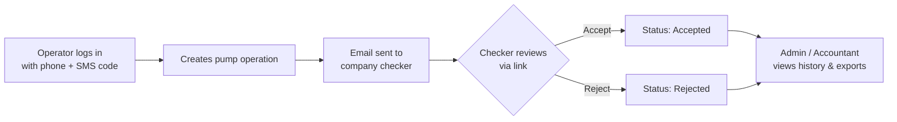
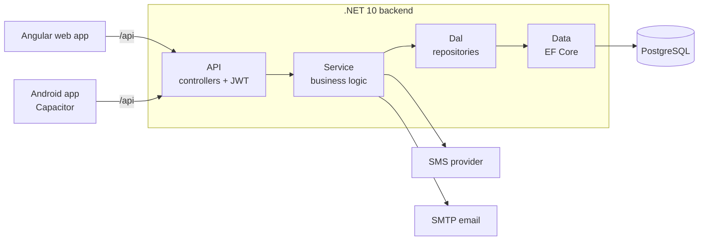

# Pompa (პომპა)

Pompa is an app for logging concrete pump operations. Pump operators record each job (company, address, plate, concrete volume). The client company's checker then gets an email link to accept or reject the record, and admins and accountants manage companies, plates and users and export reports.

## Flow



## Architecture



| Folder | What it is |
| --- | --- |
| `frontend/` | Angular 21 web app (also wrapped as an Android app in `frontend/android`) |
| `backend/API` | ASP.NET Core Web API, entry point |
| `backend/Service` | Business logic, DTOs, SMS and email |
| `backend/Dal` | Repositories |
| `backend/Data` | EF Core entities and `ProjectContext` |
| `backend/Data.PostgresMigrations` | PostgreSQL migrations |

## Running locally

You need [Docker](https://docs.docker.com/get-docker/) and [Node.js](https://nodejs.org/).

**1. Backend + database**

```bash
docker compose up --build
```

The API runs at http://localhost:5032 and Swagger at http://localhost:5032/swagger.

**2. Frontend** (in a second terminal)

```bash
cd frontend
npm install
npm start
```

Open http://localhost:4200.

**3. Log in**

Use the seeded admin number `577574401`. Locally no SMS is sent. The code appears in the backend logs:

```
[SMS DEV] 577574401 -> 1234
```

**Stop:** `docker compose down` (add `-v` to also delete the database).

## Environment variables

The backend reads its settings from environment variables. Where they come from depends on how you run it:

| How you run it | Where the variables are set |
| --- | --- |
| `docker compose up` | The `environment:` section of [`docker-compose.yml`](docker-compose.yml). It already has working local values, so you don't need to change anything. |
| `dotnet run` | `backend/API/.env`, loaded at startup. Copy it from [`backend/API/.env.example`](backend/API/.env.example). |
| Production (Vercel) | The project's environment variables in the Vercel dashboard. |

| Variable | Required | Purpose |
| --- | --- | --- |
| `DATABASE_URL` | yes | PostgreSQL connection (`Host=...;Database=...` or `postgres://...`) |
| `JWT_KEY` | yes | Secret for signing login tokens (at least 32 characters) |
| `RecreateDatabaseOnStartup` | no | `true` wipes the DB on every start (the Development default) |
| `SMS_KEY` | production | SMS provider key, used when `Sms:SendSms` is `true` |
| `SMTP_HOST`, `SMTP_PORT`, `SMTP_FROM_EMAIL` | production | Email server for review links, used when `Email:SendEmail` is `true` |
| `SMTP_USERNAME`, `SMTP_PASSWORD`, `SMTP_FROM_NAME`, `SMTP_ENABLE_SSL` | no | Extra email settings |

SMS and email are turned off in Development (`appsettings.Development.json`). That's why login codes show up in the logs instead of arriving by SMS.

The frontend has a single setting, `BACKEND_URL`, in `frontend/public/config.json`. Leave it empty so the app uses the same origin. Locally, `npm start` forwards `/api` to the backend through `frontend/proxy.conf.json`.

### Without Docker (optional)

Install the .NET 10 SDK, then:

```bash
docker compose up db                              # or use your own PostgreSQL
cp backend/API/.env.example backend/API/.env
cd backend/API && dotnet run --launch-profile http
```

### Android APK (optional)

Requires the Android SDK and a JDK.

```bash
cd frontend
npm run android:apk:linux   # Windows: npm run android:apk
```
